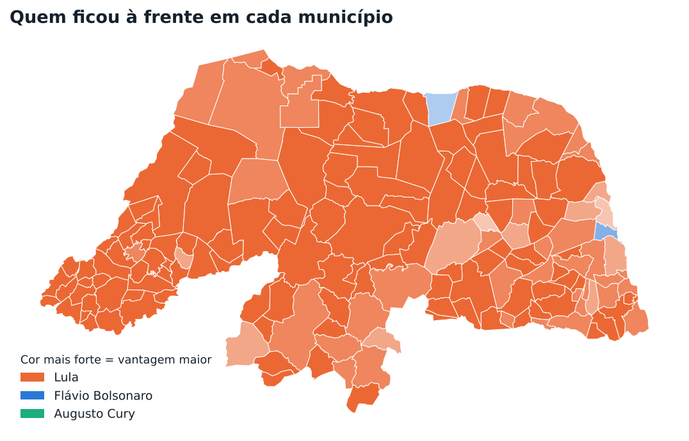
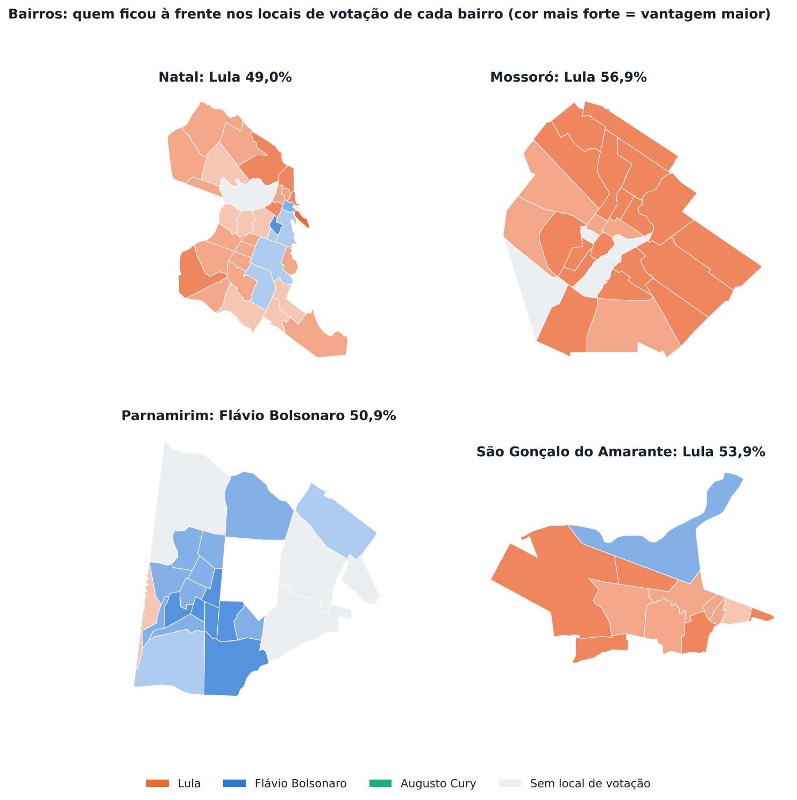

# Eleições 2026 Rio Grande do Norte

Resultados do 1º turno (4/10/2026) no Rio Grande do Norte por município, bairro e local de votação, a partir dos boletins por seção do TSE.

**Site interativo:** https://felipemechatronics.github.io/Elei-es-2026/

| Cargo | Site | Relatório |
|---|---|---|
| Presidente | [abrir](https://felipemechatronics.github.io/Elei-es-2026/?cargo=presidente) | [relatorio/presidente/RELATORIO.md](relatorio/presidente/RELATORIO.md) |
| Governador | [abrir](https://felipemechatronics.github.io/Elei-es-2026/?cargo=governador) | [relatorio/governador/RELATORIO.md](relatorio/governador/RELATORIO.md) |

- **Site** (`docs/`): mapa do estado que desce até os bairros e os locais de votação, em percentual ou em quantidade de votos, com destaques, gráficos, tabela de todos os municípios e seletor de cargo.
- **Simulador do 2º turno para Governador** (`docs/simulador.html`, [abrir](https://felipemechatronics.github.io/Elei-es-2026/simulador.html)): barra arrastável (ou valores digitados, em % ou votos) para dividir os votos de Álvaro Dias entre Allyson Bezerra, Cadu de Lula e "nenhum dos dois", e ajuste para mais ou para menos dos votos próprios de cada finalista, no estado todo ou com valores próprios em cada município. Mostra o resultado estadual, o mapa, os municípios que trocam de posição e um link para compartilhar a simulação.
- **Relatórios** (`relatorio/<cargo>/`): o mesmo conteúdo em texto, tabelas e figuras, legível direto no GitHub.
- **Dados** (`docs/dados/<cargo>/`): resultados por município, bairro e local de votação, em CSV.





## Regerar os dados

Requer Python 3.10+ e os arquivos do TSE em `dados_tse/`, que não vão para o Git (veja `.gitignore`).

```bash
pip install -r requirements.txt
python scripts/gerar_dados.py dados_tse/Urnas_Presidente.xlsx --cargo Presidente
python scripts/gerar_dados.py dados_tse/votacao_secao_2026_RN.csv --cargo Governador --anulados 50,29
python scripts/gerar_relatorio.py
```

| Script | O que faz |
|---|---|
| `scripts/gerar_dados.py` | Lê o arquivo do TSE, filtra cargo, UF e turno, soma por local, bairro e município e grava `docs/<cargo>.js`, os CSVs e `relatorio/<cargo>/resumo.json`. Cada cargo gerado entra no seletor do site. |
| `scripts/gerar_relatorio.py` | Gera as figuras e o `RELATORIO.md` de cada cargo. |
| `scripts/extrair_base.py` | (Só uma vez) monta a base geográfica em `base/` a partir do projeto de referência. |

Formatos aceitos do Portal de Dados Abertos do TSE:

- **Boletim de urna** (CSV, ZIP ou XLSX), com `DS_CARGO_PERGUNTA`, `QT_APTOS` e `QT_COMPARECIMENTO`. É o formato usado para Presidente. O eleitorado apto vem do próprio boletim.
- **votacao_secao** (CSV ou ZIP), com `DS_CARGO`. É o formato usado para Governador. O eleitorado apto vem do cadastro de locais de votação.

Opções úteis:

- `--turno 2` para o 2º turno. O site ganha um cargo à parte, como "Presidente (2º turno)".
- `--anulados 50,29`: números de candidatos com registro indeferido ou cassado, cujos votos passam a contar como nulos, como na totalização do TSE. Os arquivos por seção não trazem essa informação. Para Governador, isso faz os totais baterem exatamente com o projeto de referência.
- `config/candidatos_<cargo>.json`: nome de urna, partido e cor de cada candidato. As cores seguem a paleta do site: 0 é azul, 1 é laranja e 2 é verde-água.

## Verificação

- Presidente: votos por candidato, brancos, nulos, aptos e comparecimento conferidos município a município contra a planilha do TSE, sem divergências.
- Governador: conferido município a município e local a local contra o projeto de referência, sem divergências.

## Estrutura

```
base/        municípios, bairros e locais de votação georreferenciados (comum a todos os cargos)
config/      nomes de urna, partidos e cores por cargo
dados_tse/   arquivos brutos do TSE (não versionados)
docs/        site do GitHub Pages: index.html, geo.js, cargos.js, <cargo>.js e CSVs
relatorio/   um RELATORIO.md com figuras para cada cargo
scripts/     geração dos dados e dos relatórios
```

## Metodologia

- Percentuais de candidatos são calculados sobre os votos válidos. Comparecimento e abstenção, sobre o eleitorado apto. Brancos e nulos, sobre o comparecimento.
- O voto é atribuído ao local onde o eleitor vota, e não ao endereço onde mora.
- Cada local de votação é posicionado pela coordenada do cadastro do TSE e atribuído ao bairro do IBGE (Censo 2022) que o contém. Locais sem coordenada válida aparecem em posição aproximada e não entram em nenhum bairro. Só há bairros nos municípios que têm bairros delimitados pelo IBGE.

## Publicar no GitHub Pages

Em **Settings → Pages**, escolha **Deploy from a branch**, branch `main` e pasta `/docs`.

## Fontes e créditos

- Votos por seção, boletins de urna e cadastro de locais de votação: [TSE, Portal de Dados Abertos](https://dadosabertos.tse.jus.br/).
- Malhas de municípios e bairros: [IBGE](https://www.ibge.gov.br/geociencias/downloads-geociencias.html).
- Base geográfica (coordenadas dos locais, atribuição de bairros e eleitorado apto por local) organizada a partir do projeto [Como o RN votou para governador](https://sousapfe.github.io/eleicoesRN/) ([repositório](https://github.com/sousapfe/eleicoesRN)), de Peterson Sousa.
- Gráficos e mapas com [D3](https://d3js.org/) e matplotlib.
