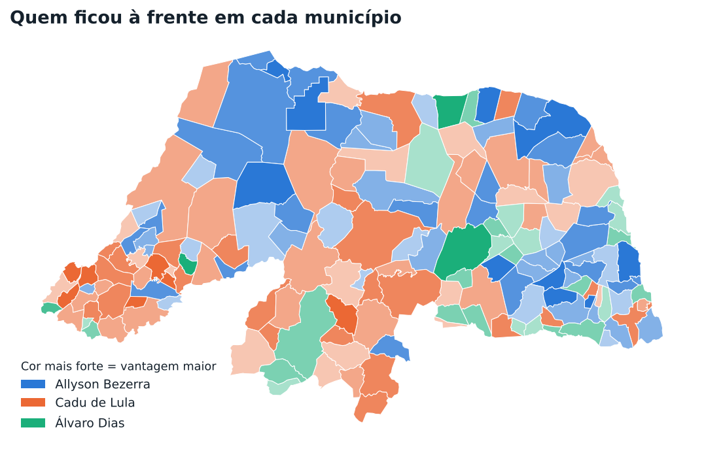
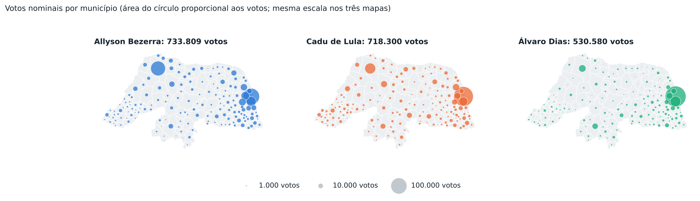
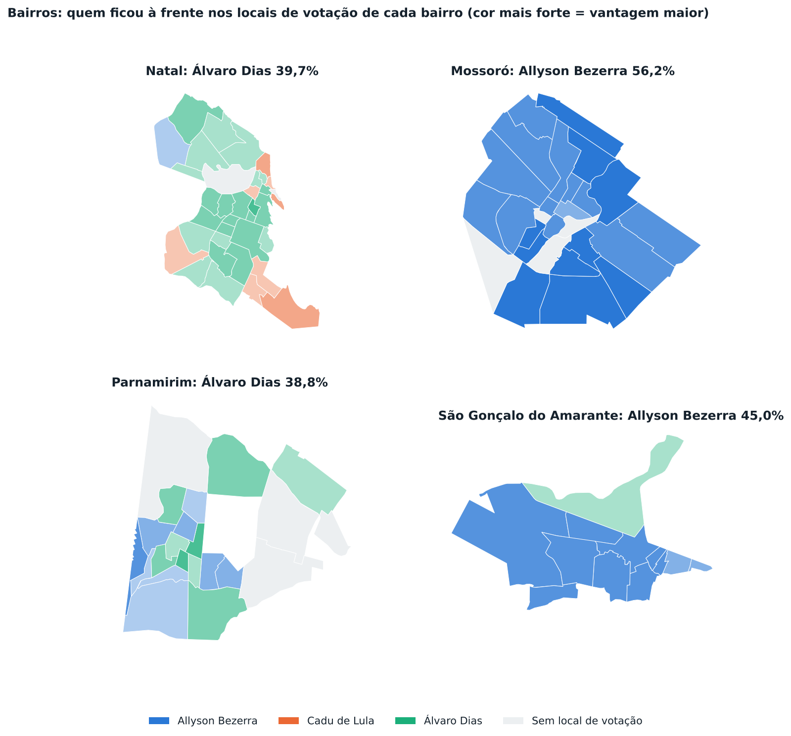

# Eleições 2026 Rio Grande do Norte: Governador, 1º turno

Relatório gerado a partir dos boletins por seção do TSE (Eleições Gerais Estaduais 2026, 04/10/2026). Percentuais de candidatos são sobre os votos válidos. Versão interativa, com mapa por bairro e por local de votação: [https://felipemechatronics.github.io/Elei-es-2026/?cargo=governador](https://felipemechatronics.github.io/Elei-es-2026/?cargo=governador).

## Resumo

- Votos válidos no estado: Allyson Bezerra (UNIÃO) 36,9%; Cadu de Lula (PT) 36,2%; Álvaro Dias (PL) 26,7%.
- Primeiro lugar por município, entre os 167 do estado: Allyson Bezerra em 65; Cadu de Lula em 73; Álvaro Dias em 29.
- Compareceram 2.167.714 dos 2.656.207 eleitores aptos (81,6%). Abstenção de 18,4%. Brancos: 3,5%; nulos: 4,8% dos votos.

| Candidato | Partido | Votos | % válidos |
|---|---|---:|---:|
| Allyson Bezerra | UNIÃO | 733.809 | 36,94% |
| Cadu de Lula | PT | 718.300 | 36,16% |
| Álvaro Dias | PL | 530.580 | 26,71% |
| Arinalda Medeiros | UP | 1.466 | 0,07% |
| Dario Melo | PSTU | 1.388 | 0,07% |
| Gladyer Godeiro | DC | 464 | 0,02% |
| Karlo Vieira | AGIR | 434 | 0,02% |
| Brancos | | 76.524 | |
| Nulos | | 104.749 | |

## O mapa dos municípios

- Mais votos para **Allyson Bezerra**: Natal (101.941), Mossoró (82.286), Parnamirim (36.937), São Gonçalo do Amarante (26.783), Macaíba (20.666).
- Mais votos para **Cadu de Lula**: Natal (147.509), Mossoró (44.202), Parnamirim (30.650), Ceará-Mirim (18.365), Assú (16.762).
- Mais votos para **Álvaro Dias**: Natal (165.210), Parnamirim (43.023), Mossoró (19.759), São Gonçalo do Amarante (16.537), Caicó (13.734).
- Maiores percentuais de **Allyson Bezerra**: Grossos (68,1%), Serra do Mel (62,1%), Serrinha (61,5%), Nísia Floresta (59,6%), Antônio Martins (59,2%).
- Maiores percentuais de **Cadu de Lula**: Frutuoso Gomes (78,4%), Doutor Severiano (73,7%), Pilões (70,9%), Coronel João Pessoa (65,6%), Macau (59,5%).
- Maiores percentuais de **Álvaro Dias**: São Tomé (56,7%), Galinhos (56,1%), Rafael Godeiro (55,6%), Venha-Ver (50,1%), Ruy Barbosa (49,1%).
- Disputas mais apertadas: Rodolfo Fernandes (Cadu de Lula por 2 votos), Jaçanã (Cadu de Lula por 10 votos), São Rafael (Allyson Bezerra por 13 votos), Serra Negra do Norte (Cadu de Lula por 15 votos), Pedro Avelino (Álvaro Dias por 18 votos).

## Tamanho da cidade

| Faixa | Municípios | Eleitorado | Allyson Bezerra | Cadu de Lula | Álvaro Dias |
|---|---:|---:|---:|---:|---:|
| Até 10 mil eleitores | 110 | 23,5% | 37,7% | 37,6% | 24,6% |
| 10 a 25 mil | 41 | 22,4% | 40,5% | 39,2% | 20,2% |
| 25 a 80 mil | 13 | 20,0% | 39,0% | 36,5% | 24,3% |
| Mais de 80 mil, exceto Natal | 2 | 12,6% | 46,3% | 29,1% | 24,4% |
| Natal | 1 | 21,5% | 24,5% | 35,4% | 39,7% |

## As maiores cidades

| Município | Aptos | Comparec. | Allyson Bezerra | Cadu de Lula | Álvaro Dias | À frente |
|---|---:|---:|---:|---:|---:|---|
| Natal | 570.792 | 79,4% | 24,5% (101.941) | 35,4% (147.509) | 39,7% (165.210) | Álvaro Dias +4,3 |
| Mossoró | 187.604 | 84,0% | 56,2% (82.286) | 30,2% (44.202) | 13,5% (19.759) | Allyson Bezerra +26,0 |
| Parnamirim | 147.053 | 82,4% | 33,3% (36.937) | 27,6% (30.650) | 38,8% (43.023) | Álvaro Dias +5,5 |
| São Gonçalo do Amarante | 77.507 | 83,8% | 45,0% (26.783) | 27,0% (16.045) | 27,8% (16.537) | Allyson Bezerra +17,2 |
| Ceará-Mirim | 60.279 | 82,1% | 41,3% (18.077) | 41,9% (18.365) | 16,6% (7.278) | Cadu de Lula +0,7 |
| Macaíba | 54.336 | 83,0% | 50,3% (20.666) | 29,6% (12.138) | 19,9% (8.179) | Allyson Bezerra +20,8 |
| Assú | 45.542 | 81,1% | 37,9% (12.771) | 49,8% (16.762) | 12,2% (4.092) | Cadu de Lula +11,9 |
| Caicó | 45.030 | 84,2% | 27,7% (9.666) | 32,7% (11.419) | 39,4% (13.734) | Álvaro Dias +6,6 |
| Extremoz | 39.503 | 82,7% | 33,3% (9.960) | 28,2% (8.416) | 38,3% (11.430) | Álvaro Dias +4,9 |
| São José de Mipibu | 35.785 | 80,7% | 37,6% (9.766) | 29,5% (7.654) | 32,7% (8.495) | Allyson Bezerra +4,9 |
| Currais Novos | 32.921 | 80,6% | 22,0% (5.149) | 49,1% (11.493) | 28,7% (6.722) | Cadu de Lula +20,4 |
| Apodi | 30.214 | 85,4% | 38,1% (8.894) | 50,6% (11.799) | 11,1% (2.599) | Cadu de Lula +12,5 |
| Touros | 28.140 | 83,1% | 56,8% (12.256) | 26,0% (5.603) | 17,2% (3.710) | Allyson Bezerra +30,8 |
| Nova Cruz | 27.945 | 80,4% | 31,8% (6.361) | 30,5% (6.091) | 37,6% (7.505) | Álvaro Dias +5,7 |
| João Câmara | 27.694 | 83,0% | 40,4% (8.673) | 48,7% (10.470) | 10,9% (2.333) | Cadu de Lula +8,4 |

## Bairro a bairro

O voto é contado no local onde o eleitor vota, e não onde ele mora. Cada bairro soma os locais de votação que ficam dentro dos seus limites (IBGE, Censo 2022). Bairros sem local de votação aparecem em cinza.

### Natal

Álvaro Dias ficou à frente em 25 bairros, Cadu de Lula ficou à frente em 8 bairros, Allyson Bezerra ficou à frente em 1 bairro.

| Bairro | Locais | Votos válidos | Allyson Bezerra | Cadu de Lula | Álvaro Dias | Abstenção |
|---|---:|---:|---:|---:|---:|---:|
| Potengi | 23 | 42.471 | 29,2% (12.397) | 33,1% (14.066) | 37,3% (15.847) | 20,5% |
| Lagoa Nova | 16 | 37.196 | 16,7% (6.200) | 38,8% (14.425) | 44,2% (16.434) | 19,0% |
| Lagoa Azul | 19 | 32.974 | 29,6% (9.762) | 31,8% (10.500) | 38,2% (12.606) | 21,3% |
| Tirol | 13 | 27.252 | 22,7% (6.179) | 33,2% (9.053) | 43,7% (11.922) | 19,8% |
| Alecrim | 14 | 22.819 | 21,2% (4.832) | 35,1% (8.012) | 43,4% (9.893) | 19,5% |
| Pitimbú | 10 | 20.962 | 19,7% (4.136) | 38,4% (8.047) | 41,5% (8.694) | 19,8% |
| Neópolis | 8 | 20.437 | 18,0% (3.672) | 41,8% (8.545) | 39,8% (8.126) | 20,1% |
| Filipe Camarão | 13 | 20.271 | 33,4% (6.780) | 32,2% (6.525) | 34,1% (6.903) | 21,5% |
| Pajuçara | 9 | 19.415 | 28,7% (5.578) | 33,1% (6.426) | 37,8% (7.341) | 22,2% |
| Nossa Senhora da Apresentação | 10 | 19.152 | 34,2% (6.547) | 32,5% (6.218) | 33,1% (6.345) | 23,9% |
| Capim Macio | 6 | 17.342 | 14,4% (2.500) | 44,2% (7.672) | 40,9% (7.091) | 22,3% |
| Candelária | 5 | 13.642 | 17,5% (2.393) | 37,8% (5.163) | 44,3% (6.040) | 19,6% |
| Cidade da Esperança | 7 | 12.721 | 22,8% (2.898) | 36,9% (4.700) | 39,9% (5.072) | 20,5% |
| Nossa Senhora de Nazaré | 4 | 11.072 | 26,4% (2.928) | 33,5% (3.707) | 39,7% (4.400) | 19,4% |
| Quintas | 7 | 10.849 | 26,0% (2.821) | 31,5% (3.416) | 42,2% (4.580) | 18,6% |
| Dix-Sept Rosado | 4 | 9.014 | 24,1% (2.173) | 33,8% (3.043) | 41,8% (3.765) | 19,2% |
| Planalto | 4 | 8.365 | 26,4% (2.205) | 34,3% (2.866) | 38,8% (3.244) | 22,0% |
| Petrópolis | 5 | 7.639 | 17,5% (1.338) | 35,3% (2.698) | 46,8% (3.578) | 20,5% |
| Cidade Nova | 5 | 7.311 | 28,5% (2.082) | 32,4% (2.372) | 38,7% (2.827) | 21,8% |
| Ponta Negra | 7 | 6.234 | 19,0% (1.187) | 43,0% (2.680) | 37,6% (2.342) | 25,7% |
| Mãe Luíza | 6 | 6.078 | 30,1% (1.829) | 39,3% (2.386) | 30,2% (1.835) | 19,9% |
| Bom Pastor | 2 | 5.449 | 26,8% (1.459) | 32,5% (1.773) | 40,5% (2.205) | 19,2% |
| Santos Reis | 4 | 5.337 | 29,8% (1.590) | 37,6% (2.006) | 32,2% (1.719) | 19,5% |
| Nordeste | 3 | 4.594 | 26,7% (1.226) | 31,1% (1.427) | 41,9% (1.926) | 18,0% |
| Igapó | 3 | 4.437 | 33,0% (1.466) | 32,6% (1.447) | 34,0% (1.507) | 16,3% |
| Redinha | 4 | 3.820 | 28,6% (1.094) | 34,7% (1.327) | 36,0% (1.375) | 22,0% |
| Guarapés | 3 | 3.410 | 27,4% (933) | 36,3% (1.239) | 35,6% (1.214) | 20,7% |
| Rocas | 2 | 3.313 | 27,7% (919) | 34,5% (1.143) | 37,2% (1.234) | 18,2% |
| Cidade Alta | 1 | 2.841 | 22,5% (639) | 40,0% (1.137) | 36,9% (1.048) | 20,1% |
| Barro Vermelho | 2 | 2.695 | 17,3% (465) | 33,5% (903) | 49,1% (1.322) | 18,2% |
| Nova Descoberta | 1 | 2.498 | 26,8% (669) | 36,0% (900) | 36,9% (921) | 23,4% |
| Lagoa Seca | 1 | 1.807 | 18,7% (338) | 35,6% (644) | 44,9% (812) | 19,2% |
| Ribeira | 1 | 1.508 | 23,3% (351) | 37,7% (568) | 38,8% (585) | 21,9% |
| Praia do Meio | 2 | 1.259 | 27,7% (349) | 36,4% (458) | 35,4% (446) | 20,8% |

### Mossoró

Allyson Bezerra ficou à frente em 23 bairros.

| Bairro | Locais | Votos válidos | Allyson Bezerra | Cadu de Lula | Álvaro Dias | Abstenção |
|---|---:|---:|---:|---:|---:|---:|
| Santo Antônio | 7 | 19.368 | 54,9% (10.627) | 30,4% (5.879) | 14,5% (2.817) | 17,0% |
| Abolição | 7 | 13.342 | 51,8% (6.914) | 31,6% (4.212) | 16,4% (2.184) | 16,7% |
| Alto de São Manoel | 5 | 12.864 | 60,1% (7.734) | 28,3% (3.642) | 11,4% (1.462) | 15,5% |
| Lagoa do Mato | 4 | 9.328 | 58,9% (5.494) | 28,1% (2.624) | 12,8% (1.191) | 14,5% |
| Bom Jardim | 4 | 8.713 | 53,9% (4.694) | 31,6% (2.757) | 14,3% (1.244) | 16,1% |
| Aeroporto | 5 | 7.586 | 56,8% (4.312) | 29,1% (2.209) | 13,7% (1.043) | 15,8% |
| Presidente Costa e Silva | 3 | 7.429 | 53,4% (3.970) | 33,9% (2.515) | 12,4% (920) | 14,7% |
| Doze Anos | 4 | 6.715 | 49,7% (3.340) | 34,7% (2.332) | 15,4% (1.035) | 14,6% |
| Centro | 3 | 6.020 | 46,5% (2.800) | 35,1% (2.115) | 18,2% (1.094) | 15,6% |
| Planalto Treze de Maio | 3 | 5.974 | 62,9% (3.760) | 25,4% (1.519) | 11,5% (685) | 15,5% |
| Dom Jaime Câmara | 2 | 4.764 | 62,9% (2.996) | 26,5% (1.263) | 10,3% (490) | 17,8% |
| Nova Betânia | 2 | 4.441 | 48,6% (2.159) | 32,9% (1.462) | 18,4% (817) | 17,2% |
| Santa Delmira | 3 | 4.185 | 57,4% (2.402) | 29,5% (1.236) | 12,9% (540) | 16,2% |
| Barrocas | 2 | 4.122 | 59,4% (2.448) | 27,4% (1.129) | 13,0% (536) | 18,2% |
| Alto da Conceição | 4 | 3.998 | 51,8% (2.069) | 33,8% (1.350) | 14,3% (573) | 12,8% |
| Paredões | 2 | 3.799 | 51,6% (1.959) | 32,3% (1.228) | 16,0% (607) | 17,3% |
| Rincão | 2 | 3.253 | 52,8% (1.716) | 33,9% (1.103) | 13,1% (425) | 17,2% |
| Belo Horizonte | 1 | 2.859 | 64,4% (1.842) | 23,6% (676) | 11,7% (335) | 15,5% |
| Redenção | 1 | 2.189 | 62,8% (1.374) | 25,2% (551) | 11,8% (258) | 17,3% |
| Alto do Sumaré | 1 | 2.111 | 59,3% (1.251) | 27,5% (581) | 13,2% (278) | 16,8% |
| Pintos | 1 | 1.569 | 62,1% (975) | 27,3% (429) | 10,4% (163) | 16,2% |
| Bom Jesus | 1 | 1.174 | 59,8% (702) | 27,5% (323) | 12,6% (148) | 15,5% |
| Dix-Sept Rosado | 1 | 274 | 53,6% (147) | 29,9% (82) | 16,1% (44) | 13,0% |

### Parnamirim

Álvaro Dias ficou à frente em 9 bairros, Allyson Bezerra ficou à frente em 9 bairros.

| Bairro | Locais | Votos válidos | Allyson Bezerra | Cadu de Lula | Álvaro Dias | Abstenção |
|---|---:|---:|---:|---:|---:|---:|
| Nova Parnamirim | 9 | 20.665 | 20,7% (4.271) | 38,7% (7.988) | 40,2% (8.309) | 18,3% |
| Emaús | 5 | 10.785 | 27,8% (3.003) | 31,0% (3.341) | 40,8% (4.402) | 16,0% |
| Cohabinal | 4 | 10.242 | 27,8% (2.845) | 27,2% (2.783) | 44,7% (4.577) | 17,2% |
| Passagem de Areia | 4 | 9.253 | 42,4% (3.925) | 21,4% (1.982) | 35,9% (3.323) | 18,1% |
| Nova Esperança | 3 | 7.056 | 36,4% (2.570) | 26,9% (1.901) | 36,2% (2.554) | 19,4% |
| Monte Castelo | 4 | 6.950 | 40,4% (2.809) | 24,2% (1.682) | 35,1% (2.441) | 15,7% |
| Santa Tereza | 3 | 5.882 | 40,9% (2.405) | 21,3% (1.255) | 37,4% (2.202) | 18,4% |
| Santos Reis | 2 | 5.877 | 38,4% (2.257) | 21,6% (1.270) | 39,8% (2.339) | 18,6% |
| Boa Esperança | 3 | 4.472 | 37,4% (1.672) | 22,5% (1.004) | 39,8% (1.782) | 15,7% |
| Cajupiranga | 3 | 4.076 | 33,3% (1.359) | 23,4% (955) | 42,8% (1.745) | 19,0% |
| Liberdade | 2 | 3.791 | 45,9% (1.740) | 21,6% (817) | 32,3% (1.226) | 16,6% |
| Vida Nova | 1 | 3.414 | 34,1% (1.164) | 26,3% (899) | 39,4% (1.344) | 17,6% |
| Rosa dos Ventos | 1 | 2.922 | 34,8% (1.016) | 23,5% (687) | 41,4% (1.211) | 17,1% |
| Bela Parnamirim | 1 | 2.471 | 47,1% (1.164) | 22,3% (552) | 30,2% (746) | 20,5% |
| Centro | 2 | 2.120 | 30,0% (635) | 22,8% (484) | 46,9% (994) | 17,4% |
| Vale do Sol | 2 | 1.901 | 37,9% (720) | 25,0% (476) | 36,9% (702) | 19,3% |
| Parque de Exposições | 2 | 1.643 | 38,5% (632) | 23,6% (388) | 37,6% (618) | 15,7% |
| Jardim Planalto | 1 | 1.538 | 43,1% (663) | 21,1% (325) | 35,6% (548) | 15,1% |

### São Gonçalo do Amarante

Allyson Bezerra ficou à frente em 11 bairros, Álvaro Dias ficou à frente em 1 bairro.

| Bairro | Locais | Votos válidos | Allyson Bezerra | Cadu de Lula | Álvaro Dias | Abstenção |
|---|---:|---:|---:|---:|---:|---:|
| Centro | 2 | 8.146 | 47,0% (3.829) | 26,6% (2.169) | 26,2% (2.135) | 15,9% |
| Amarante | 3 | 8.090 | 39,0% (3.154) | 27,7% (2.237) | 33,0% (2.672) | 15,2% |
| Jardins | 2 | 6.583 | 33,3% (2.194) | 28,1% (1.851) | 38,1% (2.511) | 15,9% |
| Santo Antônio do Potengi | 2 | 6.223 | 47,1% (2.929) | 24,9% (1.547) | 27,9% (1.734) | 17,0% |
| Jardim Lola | 3 | 5.538 | 42,8% (2.373) | 27,0% (1.494) | 29,9% (1.658) | 15,9% |
| Goladim | 1 | 4.856 | 48,1% (2.336) | 25,6% (1.244) | 26,1% (1.267) | 17,2% |
| Regomoleiro | 2 | 2.814 | 45,2% (1.272) | 28,9% (813) | 25,7% (722) | 13,4% |
| Novo Amarante | 1 | 2.266 | 46,2% (1.046) | 25,0% (567) | 28,4% (644) | 18,8% |
| Olho D'Água | 1 | 2.023 | 46,4% (938) | 26,5% (537) | 26,9% (545) | 18,8% |
| Santa Terezinha | 1 | 1.788 | 48,9% (875) | 24,7% (442) | 26,2% (468) | 19,8% |
| Guajiru | 1 | 1.141 | 52,8% (602) | 23,8% (272) | 23,4% (267) | 16,0% |
| Maçaranduba | 1 | 1.111 | 51,7% (574) | 25,4% (282) | 23,0% (255) | 16,3% |

## Abstenção

- Maior abstenção: Pedro Avelino (24,3%), Tibau (24,0%), Luís Gomes (23,3%), Venha-Ver (23,3%), Tangará (23,0%).
- Menor abstenção: Lucrécia (13,4%), São Fernando (13,9%), Timbaúba dos Batistas (13,9%), Serra do Mel (13,9%), Grossos (14,1%).

## Metodologia e fontes

- Votos por seção: TSE, Portal de Dados Abertos, arquivo `votacao_secao`. Somados por local de votação, bairro e município.
- Eleitorado apto, coordenadas dos locais de votação e atribuição de bairros: cadastro de locais do TSE e malhas do IBGE (municípios e bairros do Censo 2022), na base organizada pelo projeto [Como o RN votou para governador](https://sousapfe.github.io/eleicoesRN/), de Peterson Sousa.
- Percentuais de candidatos sobre votos válidos; comparecimento e abstenção sobre o eleitorado apto; brancos e nulos sobre o comparecimento.
- Votos dos candidatos 29, 50 (registro indeferido ou cassado) contados como nulos.
- Os partidos são inferidos pelo número de urna e podem ser corrigidos em `config/candidatos.json`.
