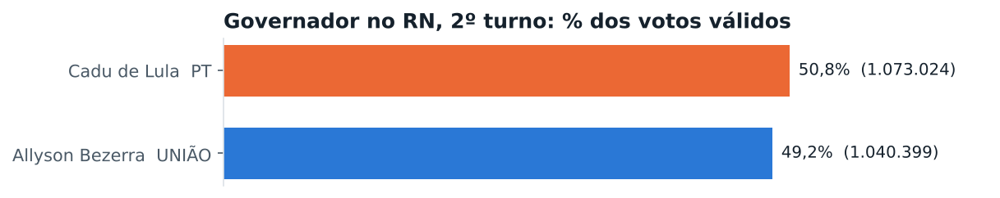
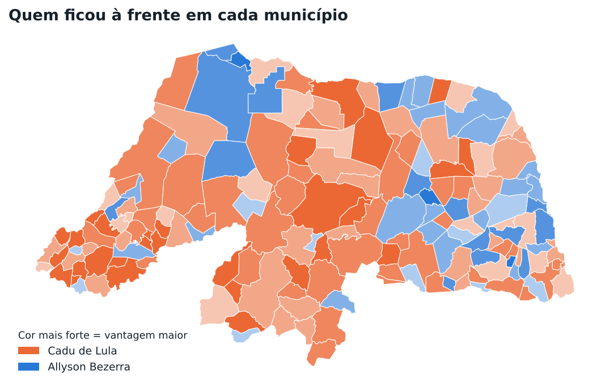
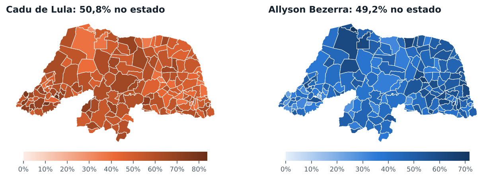
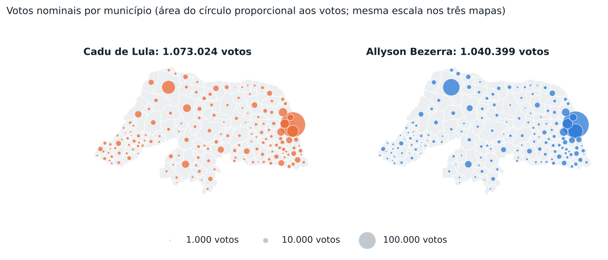
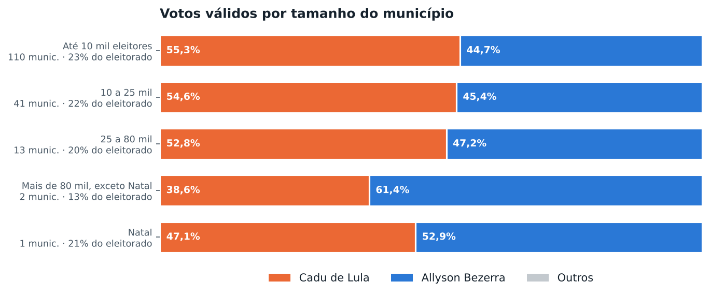
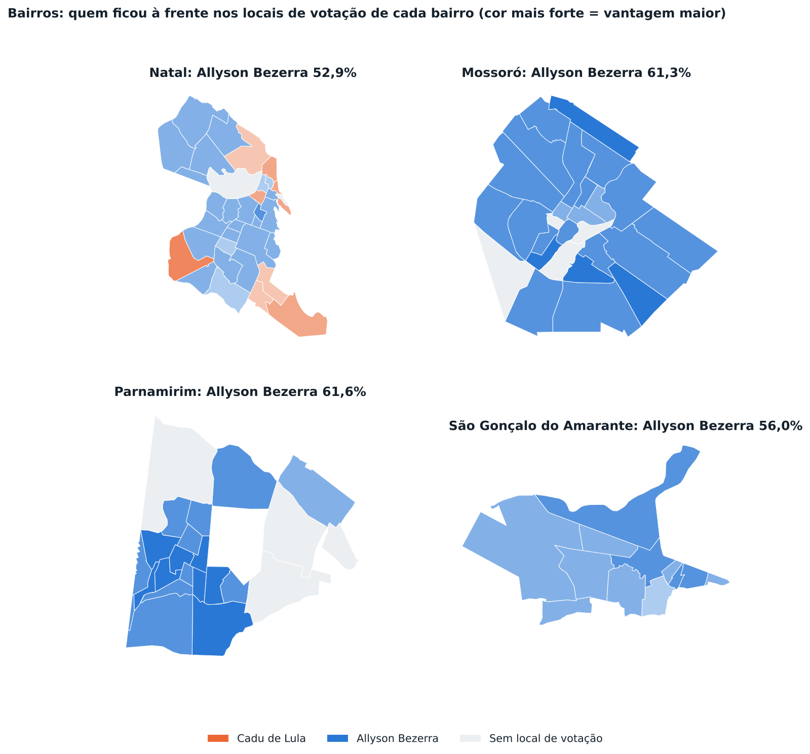
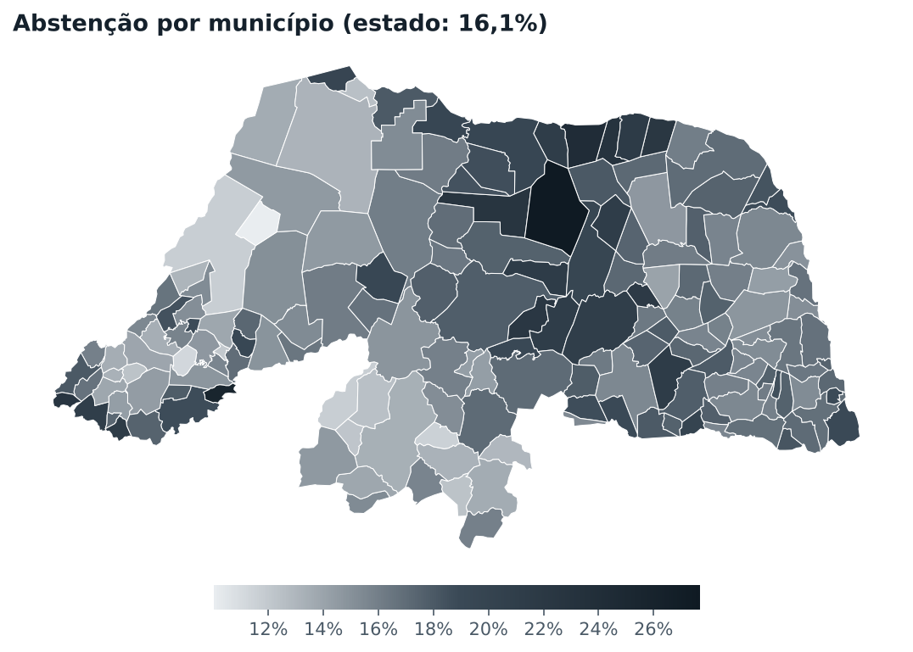

# Eleições 2026 Rio Grande do Norte: Governador, 2º turno

Relatório gerado a partir dos boletins por seção do TSE (Eleição Ordinária Estadual - 2026 2º Turno, 25/10/2026). Percentuais de candidatos são sobre os votos válidos. Versão interativa, com mapa por bairro e por local de votação: [https://felipemechatronics.github.io/Elei-es-2026/?cargo=governador_2t](https://felipemechatronics.github.io/Elei-es-2026/?cargo=governador_2t).

## Resumo

- Votos válidos no estado: Cadu de Lula (PT) 50,8%; Allyson Bezerra (UNIÃO) 49,2%.
- Primeiro lugar por município, entre os 167 do estado: Cadu de Lula em 118; Allyson Bezerra em 49.
- Compareceram 2.229.510 dos 2.656.286 eleitores aptos (83,9%). Abstenção de 16,1%. Brancos: 1,6%; nulos: 3,6% dos votos.

| Candidato | Partido | Votos | % válidos |
|---|---|---:|---:|
| Cadu de Lula | PT | 1.073.024 | 50,77% |
| Allyson Bezerra | UNIÃO | 1.040.399 | 49,23% |
| Brancos | | 35.873 | |
| Nulos | | 80.214 | |

## O mapa dos municípios

- Mais votos para **Cadu de Lula**: Natal (210.971), Mossoró (60.085), Parnamirim (45.131), São Gonçalo do Amarante (27.559), Ceará-Mirim (25.933).
- Mais votos para **Allyson Bezerra**: Natal (236.592), Mossoró (95.118), Parnamirim (72.309), São Gonçalo do Amarante (35.114), Macaíba (22.668).
- Maiores percentuais de **Cadu de Lula**: Frutuoso Gomes (83,7%), Pilões (79,7%), Doutor Severiano (76,1%), Coronel João Pessoa (72,3%), Jardim de Piranhas (72,2%).
- Maiores percentuais de **Allyson Bezerra**: Grossos (71,7%), Ruy Barbosa (65,8%), Passagem (65,6%), Galinhos (64,1%), Serra do Mel (61,9%).
- Disputas mais apertadas: Santo Antônio (Cadu de Lula por 90 votos), Viçosa (Cadu de Lula por 12 votos), São Miguel do Gostoso (Cadu de Lula por 66 votos), Jardim de Angicos (Allyson Bezerra por 27 votos), Pedro Velho (Allyson Bezerra por 105 votos).

## Tamanho da cidade

| Faixa | Municípios | Eleitorado | Cadu de Lula | Allyson Bezerra |
|---|---:|---:|---:|---:|
| Até 10 mil eleitores | 110 | 23,5% | 55,3% | 44,7% |
| 10 a 25 mil | 41 | 22,4% | 54,6% | 45,4% |
| 25 a 80 mil | 13 | 20,0% | 52,8% | 47,2% |
| Mais de 80 mil, exceto Natal | 2 | 12,6% | 38,6% | 61,4% |
| Natal | 1 | 21,5% | 47,1% | 52,9% |

## As maiores cidades

| Município | Aptos | Comparec. | Cadu de Lula | Allyson Bezerra | À frente |
|---|---:|---:|---:|---:|---|
| Natal | 570.826 | 83,3% | 47,1% (210.971) | 52,9% (236.592) | Allyson Bezerra +5,7 |
| Mossoró | 187.591 | 86,9% | 38,7% (60.085) | 61,3% (95.118) | Allyson Bezerra +22,6 |
| Parnamirim | 147.048 | 84,9% | 38,4% (45.131) | 61,6% (72.309) | Allyson Bezerra +23,1 |
| São Gonçalo do Amarante | 77.509 | 85,7% | 44,0% (27.559) | 56,0% (35.114) | Allyson Bezerra +12,1 |
| Ceará-Mirim | 60.286 | 84,5% | 53,8% (25.933) | 46,2% (22.294) | Cadu de Lula +7,5 |
| Macaíba | 54.336 | 85,3% | 48,4% (21.269) | 51,6% (22.668) | Allyson Bezerra +3,2 |
| Assú | 45.535 | 84,0% | 62,0% (22.635) | 38,0% (13.862) | Cadu de Lula +24,0 |
| Caicó | 45.040 | 86,6% | 53,9% (19.729) | 46,1% (16.886) | Cadu de Lula +7,8 |
| Extremoz | 39.501 | 85,1% | 43,3% (13.700) | 56,7% (17.928) | Allyson Bezerra +13,4 |
| São José de Mipibu | 35.792 | 83,5% | 52,2% (14.617) | 47,8% (13.387) | Cadu de Lula +4,4 |
| Currais Novos | 32.918 | 82,9% | 59,8% (15.173) | 40,2% (10.197) | Cadu de Lula +19,6 |
| Apodi | 30.217 | 88,3% | 63,3% (16.166) | 36,7% (9.361) | Cadu de Lula +26,7 |
| Touros | 28.146 | 83,0% | 46,7% (10.342) | 53,3% (11.825) | Allyson Bezerra +6,7 |
| Nova Cruz | 27.946 | 83,2% | 60,4% (13.184) | 39,6% (8.660) | Cadu de Lula +20,7 |
| João Câmara | 27.696 | 85,3% | 55,3% (12.517) | 44,7% (10.105) | Cadu de Lula +10,7 |

## Bairro a bairro

O voto é contado no local onde o eleitor vota, e não onde ele mora. Cada bairro soma os locais de votação que ficam dentro dos seus limites (IBGE, Censo 2022). Bairros sem local de votação aparecem em cinza.

### Natal

Allyson Bezerra ficou à frente em 25 bairros, Cadu de Lula ficou à frente em 9 bairros.

| Bairro | Locais | Votos válidos | Cadu de Lula | Allyson Bezerra | Abstenção |
|---|---:|---:|---:|---:|---:|
| Potengi | 23 | 46.257 | 44,9% (20.767) | 55,1% (25.490) | 16,0% |
| Lagoa Nova | 16 | 38.501 | 47,4% (18.250) | 52,6% (20.251) | 16,5% |
| Lagoa Azul | 19 | 36.143 | 45,5% (16.429) | 54,5% (19.714) | 16,7% |
| Tirol | 13 | 28.723 | 43,8% (12.578) | 56,2% (16.145) | 16,8% |
| Alecrim | 14 | 24.031 | 47,2% (11.340) | 52,8% (12.691) | 17,0% |
| Filipe Camarão | 13 | 22.733 | 46,7% (10.605) | 53,3% (12.128) | 16,0% |
| Pitimbú | 10 | 22.622 | 47,7% (10.789) | 52,3% (11.833) | 15,3% |
| Neópolis | 8 | 21.671 | 50,2% (10.884) | 49,8% (10.787) | 16,2% |
| Nossa Senhora da Apresentação | 10 | 21.573 | 45,5% (9.817) | 54,5% (11.756) | 17,8% |
| Pajuçara | 9 | 21.193 | 46,2% (9.785) | 53,8% (11.408) | 18,1% |
| Capim Macio | 6 | 18.076 | 51,3% (9.271) | 48,7% (8.805) | 18,7% |
| Candelária | 5 | 14.224 | 46,6% (6.635) | 53,4% (7.589) | 16,4% |
| Cidade da Esperança | 7 | 13.629 | 49,2% (6.699) | 50,8% (6.930) | 15,9% |
| Nossa Senhora de Nazaré | 4 | 11.983 | 45,6% (5.465) | 54,4% (6.518) | 15,3% |
| Quintas | 7 | 11.614 | 45,9% (5.331) | 54,1% (6.283) | 15,3% |
| Dix-Sept Rosado | 4 | 9.702 | 46,9% (4.548) | 53,1% (5.154) | 15,7% |
| Planalto | 4 | 9.210 | 46,7% (4.304) | 53,3% (4.906) | 17,1% |
| Cidade Nova | 5 | 8.077 | 46,0% (3.714) | 54,0% (4.363) | 16,6% |
| Petrópolis | 5 | 7.988 | 46,2% (3.691) | 53,8% (4.297) | 18,0% |
| Mãe Luíza | 6 | 6.808 | 55,7% (3.793) | 44,3% (3.015) | 16,6% |
| Ponta Negra | 7 | 6.731 | 52,5% (3.537) | 47,5% (3.194) | 21,2% |
| Bom Pastor | 2 | 5.943 | 47,3% (2.813) | 52,7% (3.130) | 15,3% |
| Santos Reis | 4 | 5.756 | 54,6% (3.145) | 45,4% (2.611) | 16,8% |
| Nordeste | 3 | 4.896 | 44,2% (2.163) | 55,8% (2.733) | 15,2% |
| Igapó | 3 | 4.687 | 44,7% (2.094) | 55,3% (2.593) | 13,9% |
| Redinha | 4 | 4.230 | 51,4% (2.173) | 48,6% (2.057) | 18,0% |
| Guarapés | 3 | 3.685 | 57,8% (2.131) | 42,2% (1.554) | 16,8% |
| Rocas | 2 | 3.556 | 49,7% (1.766) | 50,3% (1.790) | 15,2% |
| Cidade Alta | 1 | 2.988 | 53,9% (1.610) | 46,1% (1.378) | 18,1% |
| Barro Vermelho | 2 | 2.762 | 41,6% (1.150) | 58,4% (1.612) | 16,4% |
| Nova Descoberta | 1 | 2.668 | 47,3% (1.262) | 52,7% (1.406) | 19,2% |
| Lagoa Seca | 1 | 1.890 | 46,7% (883) | 53,3% (1.007) | 17,1% |
| Ribeira | 1 | 1.637 | 49,1% (804) | 50,9% (833) | 16,5% |
| Praia do Meio | 2 | 1.337 | 54,2% (724) | 45,8% (613) | 17,1% |

### Mossoró

Allyson Bezerra ficou à frente em 23 bairros.

| Bairro | Locais | Votos válidos | Cadu de Lula | Allyson Bezerra | Abstenção |
|---|---:|---:|---:|---:|---:|
| Santo Antônio | 7 | 20.444 | 39,5% (8.074) | 60,5% (12.370) | 14,3% |
| Abolição | 7 | 13.967 | 41,1% (5.745) | 58,9% (8.222) | 13,9% |
| Alto de São Manoel | 5 | 13.491 | 36,2% (4.889) | 63,8% (8.602) | 12,8% |
| Lagoa do Mato | 4 | 9.938 | 36,5% (3.628) | 63,5% (6.310) | 11,6% |
| Bom Jardim | 4 | 9.340 | 40,7% (3.801) | 59,3% (5.539) | 12,7% |
| Aeroporto | 5 | 8.160 | 38,0% (3.097) | 62,0% (5.063) | 12,7% |
| Presidente Costa e Silva | 3 | 7.733 | 41,9% (3.239) | 58,1% (4.494) | 12,5% |
| Doze Anos | 4 | 6.951 | 43,8% (3.046) | 56,2% (3.905) | 12,3% |
| Planalto Treze de Maio | 3 | 6.350 | 32,6% (2.071) | 67,4% (4.279) | 11,9% |
| Centro | 3 | 6.241 | 44,2% (2.761) | 55,8% (3.480) | 13,0% |
| Dom Jaime Câmara | 2 | 5.197 | 32,8% (1.707) | 67,2% (3.490) | 14,3% |
| Nova Betânia | 2 | 4.621 | 41,3% (1.910) | 58,7% (2.711) | 14,5% |
| Barrocas | 2 | 4.505 | 36,5% (1.646) | 63,5% (2.859) | 13,9% |
| Santa Delmira | 3 | 4.425 | 39,1% (1.729) | 60,9% (2.696) | 13,4% |
| Alto da Conceição | 4 | 4.240 | 41,1% (1.741) | 58,9% (2.499) | 10,9% |
| Paredões | 2 | 4.010 | 43,4% (1.741) | 56,6% (2.269) | 14,5% |
| Rincão | 2 | 3.411 | 41,1% (1.401) | 58,9% (2.010) | 14,3% |
| Belo Horizonte | 1 | 3.112 | 32,9% (1.025) | 67,1% (2.087) | 13,1% |
| Redenção | 1 | 2.364 | 34,8% (823) | 65,2% (1.541) | 13,7% |
| Alto do Sumaré | 1 | 2.261 | 35,6% (805) | 64,4% (1.456) | 13,4% |
| Pintos | 1 | 1.658 | 36,9% (611) | 63,1% (1.047) | 14,2% |
| Bom Jesus | 1 | 1.314 | 37,4% (492) | 62,6% (822) | 10,1% |
| Dix-Sept Rosado | 1 | 288 | 40,6% (117) | 59,4% (171) | 10,7% |

### Parnamirim

Allyson Bezerra ficou à frente em 18 bairros.

| Bairro | Locais | Votos válidos | Cadu de Lula | Allyson Bezerra | Abstenção |
|---|---:|---:|---:|---:|---:|
| Nova Parnamirim | 9 | 21.721 | 46,9% (10.184) | 53,1% (11.537) | 15,4% |
| Emaús | 5 | 11.269 | 41,4% (4.664) | 58,6% (6.605) | 14,1% |
| Cohabinal | 4 | 10.645 | 35,6% (3.790) | 64,4% (6.855) | 15,1% |
| Passagem de Areia | 4 | 9.930 | 34,2% (3.395) | 65,8% (6.535) | 15,0% |
| Nova Esperança | 3 | 7.490 | 39,2% (2.939) | 60,8% (4.551) | 17,0% |
| Monte Castelo | 4 | 7.393 | 37,0% (2.734) | 63,0% (4.659) | 13,5% |
| Santa Tereza | 3 | 6.451 | 33,7% (2.172) | 66,3% (4.279) | 14,8% |
| Santos Reis | 2 | 6.259 | 34,0% (2.127) | 66,0% (4.132) | 16,0% |
| Boa Esperança | 3 | 4.670 | 33,6% (1.567) | 66,4% (3.103) | 14,0% |
| Cajupiranga | 3 | 4.305 | 32,9% (1.417) | 67,1% (2.888) | 16,5% |
| Liberdade | 2 | 4.022 | 35,3% (1.420) | 64,7% (2.602) | 14,6% |
| Vida Nova | 1 | 3.647 | 36,6% (1.336) | 63,4% (2.311) | 15,3% |
| Rosa dos Ventos | 1 | 3.135 | 33,0% (1.036) | 67,0% (2.099) | 14,1% |
| Bela Parnamirim | 1 | 2.708 | 38,3% (1.036) | 61,7% (1.672) | 17,0% |
| Centro | 2 | 2.179 | 32,6% (711) | 67,4% (1.468) | 15,7% |
| Vale do Sol | 2 | 2.045 | 37,3% (762) | 62,7% (1.283) | 15,9% |
| Parque de Exposições | 2 | 1.735 | 35,6% (618) | 64,4% (1.117) | 14,5% |
| Jardim Planalto | 1 | 1.610 | 32,9% (530) | 67,1% (1.080) | 13,5% |

### São Gonçalo do Amarante

Allyson Bezerra ficou à frente em 12 bairros.

| Bairro | Locais | Votos válidos | Cadu de Lula | Allyson Bezerra | Abstenção |
|---|---:|---:|---:|---:|---:|
| Centro | 2 | 8.559 | 44,0% (3.767) | 56,0% (4.792) | 14,3% |
| Amarante | 3 | 8.553 | 41,4% (3.540) | 58,6% (5.013) | 13,3% |
| Jardins | 2 | 6.961 | 39,6% (2.757) | 60,4% (4.204) | 13,2% |
| Santo Antônio do Potengi | 2 | 6.552 | 43,9% (2.875) | 56,1% (3.677) | 15,2% |
| Jardim Lola | 3 | 5.815 | 45,2% (2.630) | 54,8% (3.185) | 14,7% |
| Goladim | 1 | 5.191 | 42,7% (2.218) | 57,3% (2.973) | 14,6% |
| Regomoleiro | 2 | 2.892 | 49,1% (1.420) | 50,9% (1.472) | 12,5% |
| Novo Amarante | 1 | 2.449 | 40,8% (999) | 59,2% (1.450) | 15,9% |
| Olho D'Água | 1 | 2.099 | 42,4% (889) | 57,6% (1.210) | 17,3% |
| Santa Terezinha | 1 | 1.896 | 42,6% (807) | 57,4% (1.089) | 16,5% |
| Guajiru | 1 | 1.198 | 44,9% (538) | 55,1% (660) | 14,7% |
| Maçaranduba | 1 | 1.180 | 45,9% (542) | 54,1% (638) | 14,2% |

## Abstenção

- Maior abstenção: Pedro Avelino (27,7%), João Dias (25,7%), Galinhos (24,3%), Caiçara do Norte (23,0%), Afonso Bezerra (22,8%).
- Menor abstenção: Felipe Guerra (10,0%), Serrinha dos Pintos (11,2%), São José do Seridó (11,6%), Apodi (11,7%), Jardim de Piranhas (11,7%).

## Metodologia e fontes

- Votos por seção: TSE, Portal de Dados Abertos, arquivo `votacao_secao`. Somados por local de votação, bairro e município.
- Eleitorado apto, coordenadas dos locais de votação e atribuição de bairros: cadastro de locais do TSE e malhas do IBGE (municípios e bairros do Censo 2022), na base organizada pelo projeto [Como o RN votou para governador](https://sousapfe.github.io/eleicoesRN/), de Peterson Sousa.
- Percentuais de candidatos sobre votos válidos; comparecimento e abstenção sobre o eleitorado apto; brancos e nulos sobre o comparecimento.
- Os partidos são inferidos pelo número de urna e podem ser corrigidos em `config/candidatos.json`.
