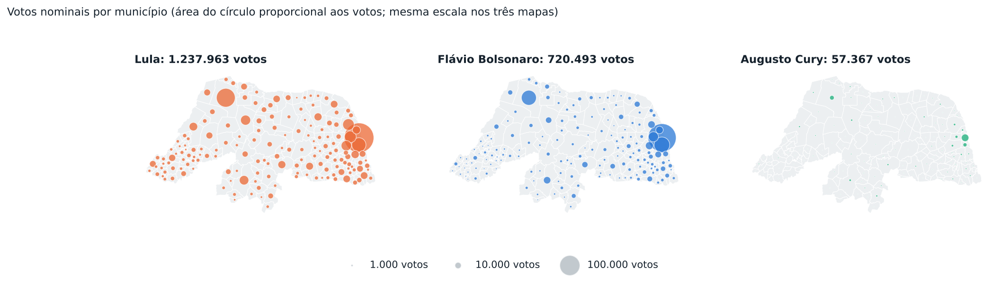

# Eleições 2026 Rio Grande do Norte: Presidente, 1º turno

Relatório gerado a partir dos boletins por seção do TSE (Eleição Geral Federal 2026, 04/10/2026). Percentuais de candidatos são sobre os votos válidos. Versão interativa, com mapa por bairro e por local de votação: [https://felipemechatronics.github.io/Elei-es-2026/?cargo=presidente](https://felipemechatronics.github.io/Elei-es-2026/?cargo=presidente).

## Resumo

- Votos válidos no estado: Lula (PT) 59,7%; Flávio Bolsonaro (PL) 34,8%; Augusto Cury (AVANTE) 2,8%.
- Primeiro lugar por município, entre os 167 do estado: Lula em 165; Flávio Bolsonaro em 2.
- Compareceram 2.171.013 dos 2.659.825 eleitores aptos (81,6%). Abstenção de 18,4%. Brancos: 1,5%; nulos: 3,0% dos votos.

| Candidato | Partido | Votos | % válidos |
|---|---|---:|---:|
| Lula | PT | 1.237.963 | 59,75% |
| Flávio Bolsonaro | PL | 720.493 | 34,77% |
| Augusto Cury | AVANTE | 57.367 | 2,77% |
| Renan Santos | MISSÃO | 35.261 | 1,70% |
| Ronaldo Caiado | PSD | 16.407 | 0,79% |
| Zema | NOVO | 1.525 | 0,07% |
| Samara | UP | 1.228 | 0,06% |
| Hertz Dias | PSTU | 572 | 0,03% |
| Clariana Barao | DC | 405 | 0,02% |
| Edmilson Costa | PCB | 315 | 0,02% |
| Veterinário Wilson Grassi | DEMOCRATA | 185 | 0,01% |
| Rui Costa Pimenta | PCO | 177 | 0,01% |
| Leonardo Avalanche | PRTB | 63 | 0,00% |
| Brancos | | 33.172 | |
| Nulos | | 65.880 | |

## O mapa dos municípios

- Mais votos para **Lula**: Natal (213.790), Mossoró (85.507), Parnamirim (49.084), São Gonçalo do Amarante (33.449), Ceará-Mirim (31.895).
- Mais votos para **Flávio Bolsonaro**: Natal (192.739), Parnamirim (59.345), Mossoró (54.321), São Gonçalo do Amarante (24.704), Macaíba (14.839).
- Mais votos para **Augusto Cury**: Natal (13.267), Mossoró (4.986), Parnamirim (3.739), São Gonçalo do Amarante (1.984), Macaíba (1.277).
- Maiores percentuais de **Lula**: Paraná (83,3%), Pilões (82,9%), Luís Gomes (82,8%), José da Penha (81,6%), Marcelino Vieira (80,8%).
- Maiores percentuais de **Flávio Bolsonaro**: Parnamirim (50,9%), Galinhos (48,3%), Ruy Barbosa (46,2%), Natal (44,2%), São Paulo do Potengi (44,0%).
- Maiores percentuais de **Augusto Cury**: Carnaúba dos Dantas (7,3%), Santana do Seridó (6,6%), Parelhas (6,0%), São José do Seridó (4,3%), Jardim do Seridó (3,9%).
- Disputas mais apertadas: Galinhos (Flávio Bolsonaro por 48 votos), Ruy Barbosa (Lula por 134 votos), Natal (Lula por 21.051 votos), Carnaúba dos Dantas (Lula por 321 votos), Extremoz (Lula por 2.095 votos).

## Tamanho da cidade

| Faixa | Municípios | Eleitorado | Lula | Flávio Bolsonaro | Augusto Cury |
|---|---:|---:|---:|---:|---:|
| Até 10 mil eleitores | 110 | 23,5% | 68,0% | 27,7% | 2,4% |
| 10 a 25 mil | 41 | 22,4% | 65,5% | 29,8% | 2,6% |
| 25 a 80 mil | 13 | 20,0% | 60,9% | 33,8% | 2,8% |
| Mais de 80 mil, exceto Natal | 2 | 12,6% | 50,5% | 42,6% | 3,3% |
| Natal | 1 | 21,5% | 49,0% | 44,2% | 3,0% |

## As maiores cidades

| Município | Aptos | Comparec. | Lula | Flávio Bolsonaro | Augusto Cury | À frente |
|---|---:|---:|---:|---:|---:|---|
| Natal | 573.148 | 79,5% | 49,0% (213.790) | 44,2% (192.739) | 3,0% (13.267) | Lula +4,8 |
| Mossoró | 188.013 | 84,0% | 56,9% (85.507) | 36,2% (54.321) | 3,3% (4.986) | Lula +20,8 |
| Parnamirim | 147.649 | 82,4% | 42,1% (49.084) | 50,9% (59.345) | 3,2% (3.739) | Flávio Bolsonaro +8,8 |
| São Gonçalo do Amarante | 77.509 | 83,8% | 53,9% (33.449) | 39,8% (24.704) | 3,2% (1.984) | Lula +14,1 |
| Ceará-Mirim | 60.280 | 82,1% | 67,7% (31.895) | 27,5% (12.957) | 2,5% (1.177) | Lula +40,2 |
| Macaíba | 54.350 | 83,0% | 59,9% (25.616) | 34,7% (14.839) | 3,0% (1.277) | Lula +25,2 |
| Assú | 45.551 | 81,1% | 68,4% (24.169) | 26,5% (9.376) | 2,5% (889) | Lula +41,9 |
| Caicó | 45.036 | 84,2% | 58,9% (21.376) | 35,1% (12.738) | 3,3% (1.199) | Lula +23,8 |
| Extremoz | 39.504 | 82,7% | 50,4% (15.787) | 43,7% (13.692) | 3,0% (938) | Lula +6,7 |
| São José de Mipibu | 35.789 | 80,7% | 57,2% (15.658) | 37,6% (10.291) | 2,8% (757) | Lula +19,6 |
| Currais Novos | 32.922 | 80,6% | 59,3% (14.921) | 35,0% (8.808) | 3,1% (791) | Lula +24,3 |
| Apodi | 30.219 | 85,4% | 70,1% (17.301) | 23,7% (5.839) | 2,8% (699) | Lula +46,5 |
| Touros | 28.142 | 83,1% | 59,2% (13.200) | 36,4% (8.127) | 2,5% (548) | Lula +22,7 |
| Nova Cruz | 27.948 | 80,4% | 61,9% (13.168) | 34,0% (7.238) | 2,3% (484) | Lula +27,9 |
| João Câmara | 27.705 | 83,1% | 67,4% (14.852) | 27,9% (6.155) | 2,8% (621) | Lula +39,5 |

## Bairro a bairro

O voto é contado no local onde o eleitor vota, e não onde ele mora. Cada bairro soma os locais de votação que ficam dentro dos seus limites (IBGE, Censo 2022). Bairros sem local de votação aparecem em cinza.

### Natal

Lula ficou à frente em 28 bairros, Flávio Bolsonaro ficou à frente em 6 bairros.

| Bairro | Locais | Votos válidos | Lula | Flávio Bolsonaro | Augusto Cury | Abstenção |
|---|---:|---:|---:|---:|---:|---:|
| Potengi | 23 | 44.497 | 48,8% (21.696) | 44,3% (19.715) | 3,3% (1.484) | 20,4% |
| Lagoa Nova | 16 | 38.648 | 45,0% (17.387) | 47,9% (18.524) | 2,5% (973) | 18,9% |
| Lagoa Azul | 19 | 34.703 | 50,7% (17.611) | 42,1% (14.600) | 3,5% (1.198) | 21,3% |
| Tirol | 13 | 28.485 | 44,0% (12.522) | 48,8% (13.894) | 2,9% (834) | 19,8% |
| Alecrim | 14 | 23.913 | 47,2% (11.287) | 46,4% (11.093) | 2,8% (671) | 19,5% |
| Pitimbú | 10 | 21.885 | 46,7% (10.229) | 45,9% (10.051) | 3,2% (691) | 19,7% |
| Filipe Camarão | 13 | 21.469 | 52,8% (11.335) | 40,5% (8.701) | 3,3% (706) | 21,5% |
| Neópolis | 8 | 21.192 | 49,0% (10.382) | 44,6% (9.459) | 2,7% (574) | 20,0% |
| Pajuçara | 9 | 20.417 | 49,6% (10.118) | 43,2% (8.817) | 3,5% (707) | 22,2% |
| Nossa Senhora da Apresentação | 10 | 20.245 | 51,2% (10.369) | 41,4% (8.385) | 3,5% (710) | 23,9% |
| Capim Macio | 6 | 17.946 | 48,6% (8.715) | 44,8% (8.034) | 2,5% (443) | 22,1% |
| Candelária | 5 | 14.055 | 44,9% (6.316) | 48,1% (6.764) | 2,6% (362) | 19,6% |
| Cidade da Esperança | 7 | 13.160 | 49,9% (6.568) | 43,8% (5.758) | 3,0% (396) | 20,5% |
| Nossa Senhora de Nazaré | 4 | 11.641 | 49,3% (5.741) | 43,8% (5.100) | 3,3% (382) | 19,4% |
| Quintas | 7 | 11.372 | 48,4% (5.507) | 45,3% (5.150) | 3,2% (363) | 18,6% |
| Dix-Sept Rosado | 4 | 9.505 | 49,3% (4.685) | 44,1% (4.191) | 3,1% (297) | 19,2% |
| Planalto | 4 | 8.838 | 49,4% (4.369) | 43,1% (3.808) | 3,6% (314) | 21,9% |
| Petrópolis | 5 | 8.024 | 43,4% (3.485) | 49,4% (3.963) | 2,6% (208) | 20,4% |
| Cidade Nova | 5 | 7.721 | 50,5% (3.901) | 43,2% (3.333) | 2,8% (219) | 21,8% |
| Ponta Negra | 7 | 6.907 | 52,8% (3.645) | 41,8% (2.884) | 2,2% (151) | 25,0% |
| Mãe Luíza | 6 | 6.629 | 61,8% (4.098) | 31,6% (2.098) | 3,5% (234) | 19,8% |
| Bom Pastor | 2 | 5.726 | 51,8% (2.965) | 42,3% (2.420) | 2,9% (166) | 19,2% |
| Santos Reis | 4 | 5.640 | 59,5% (3.356) | 34,4% (1.938) | 2,9% (162) | 19,5% |
| Nordeste | 3 | 4.802 | 47,5% (2.280) | 45,7% (2.195) | 3,8% (181) | 18,0% |
| Igapó | 3 | 4.631 | 51,2% (2.373) | 41,4% (1.916) | 3,3% (153) | 16,4% |
| Redinha | 4 | 4.074 | 57,6% (2.347) | 37,4% (1.524) | 2,4% (97) | 21,9% |
| Guarapés | 3 | 3.642 | 60,8% (2.213) | 32,9% (1.200) | 3,0% (108) | 20,7% |
| Rocas | 2 | 3.464 | 52,6% (1.822) | 40,2% (1.393) | 3,7% (129) | 18,2% |
| Cidade Alta | 1 | 2.993 | 55,6% (1.663) | 38,0% (1.138) | 2,8% (85) | 20,0% |
| Barro Vermelho | 2 | 2.782 | 38,3% (1.065) | 54,3% (1.512) | 2,5% (70) | 18,1% |
| Nova Descoberta | 1 | 2.585 | 51,5% (1.331) | 42,9% (1.108) | 2,3% (59) | 23,4% |
| Lagoa Seca | 1 | 1.864 | 45,1% (840) | 48,3% (900) | 2,8% (52) | 19,2% |
| Ribeira | 1 | 1.562 | 51,0% (796) | 41,7% (651) | 2,9% (45) | 21,9% |
| Praia do Meio | 2 | 1.331 | 55,4% (737) | 38,8% (516) | 3,2% (42) | 20,7% |

### Mossoró

Lula ficou à frente em 23 bairros.

| Bairro | Locais | Votos válidos | Lula | Flávio Bolsonaro | Augusto Cury | Abstenção |
|---|---:|---:|---:|---:|---:|---:|
| Santo Antônio | 7 | 19.872 | 57,0% (11.335) | 36,2% (7.192) | 3,3% (660) | 17,0% |
| Abolição | 7 | 13.652 | 54,0% (7.377) | 38,8% (5.294) | 3,2% (443) | 16,7% |
| Alto de São Manoel | 5 | 12.997 | 56,2% (7.298) | 36,5% (4.750) | 3,6% (467) | 15,5% |
| Lagoa do Mato | 4 | 9.562 | 56,3% (5.388) | 37,2% (3.560) | 3,1% (294) | 14,5% |
| Bom Jardim | 4 | 8.941 | 59,5% (5.324) | 34,4% (3.074) | 3,3% (297) | 16,1% |
| Aeroporto | 5 | 7.843 | 57,3% (4.494) | 35,7% (2.801) | 3,3% (259) | 15,8% |
| Presidente Costa e Silva | 3 | 7.690 | 59,1% (4.541) | 33,7% (2.594) | 3,2% (247) | 14,5% |
| Doze Anos | 4 | 6.889 | 53,9% (3.710) | 39,3% (2.708) | 2,9% (200) | 14,6% |
| Centro | 3 | 6.194 | 53,4% (3.308) | 39,6% (2.452) | 3,1% (189) | 15,8% |
| Planalto Treze de Maio | 3 | 6.046 | 54,7% (3.305) | 38,2% (2.310) | 3,6% (218) | 15,5% |
| Dom Jaime Câmara | 2 | 4.908 | 59,1% (2.902) | 34,7% (1.704) | 3,0% (145) | 17,8% |
| Nova Betânia | 2 | 4.536 | 49,8% (2.260) | 43,2% (1.959) | 3,4% (152) | 17,2% |
| Santa Delmira | 3 | 4.303 | 54,6% (2.351) | 38,0% (1.637) | 3,2% (138) | 16,2% |
| Barrocas | 2 | 4.255 | 58,7% (2.499) | 33,3% (1.415) | 3,9% (165) | 18,2% |
| Alto da Conceição | 4 | 4.110 | 56,4% (2.320) | 37,6% (1.547) | 2,6% (106) | 12,8% |
| Paredões | 2 | 3.890 | 57,4% (2.232) | 36,0% (1.400) | 3,2% (126) | 17,3% |
| Rincão | 2 | 3.288 | 56,8% (1.868) | 36,1% (1.187) | 3,1% (103) | 17,2% |
| Belo Horizonte | 1 | 2.947 | 56,4% (1.662) | 36,9% (1.086) | 3,5% (104) | 15,5% |
| Redenção | 1 | 2.234 | 57,6% (1.286) | 34,3% (767) | 4,1% (91) | 17,3% |
| Alto do Sumaré | 1 | 2.161 | 51,1% (1.105) | 38,1% (823) | 4,7% (101) | 16,8% |
| Pintos | 1 | 1.617 | 55,8% (902) | 34,4% (556) | 5,2% (84) | 16,2% |
| Bom Jesus | 1 | 1.238 | 61,6% (762) | 32,8% (406) | 3,4% (42) | 15,5% |
| Dix-Sept Rosado | 1 | 291 | 52,6% (153) | 41,6% (121) | 3,1% (9) | 13,0% |

### Parnamirim

Flávio Bolsonaro ficou à frente em 17 bairros, Lula ficou à frente em 1 bairro.

| Bairro | Locais | Votos válidos | Lula | Flávio Bolsonaro | Augusto Cury | Abstenção |
|---|---:|---:|---:|---:|---:|---:|
| Nova Parnamirim | 9 | 21.615 | 45,0% (9.732) | 47,0% (10.151) | 3,1% (671) | 18,2% |
| Emaús | 5 | 11.329 | 42,3% (4.790) | 50,3% (5.702) | 3,2% (365) | 16,0% |
| Cohabinal | 4 | 10.689 | 36,8% (3.938) | 55,7% (5.952) | 3,3% (348) | 17,2% |
| Passagem de Areia | 4 | 9.689 | 42,4% (4.106) | 51,2% (4.957) | 3,5% (336) | 18,1% |
| Nova Esperança | 3 | 7.443 | 44,4% (3.304) | 48,7% (3.624) | 3,5% (261) | 19,4% |
| Monte Castelo | 4 | 7.300 | 44,0% (3.213) | 49,5% (3.617) | 3,2% (234) | 15,7% |
| Santa Tereza | 3 | 6.263 | 40,8% (2.558) | 52,3% (3.276) | 3,6% (224) | 18,4% |
| Santos Reis | 2 | 6.146 | 39,9% (2.452) | 54,7% (3.363) | 2,6% (159) | 18,6% |
| Boa Esperança | 3 | 4.674 | 36,6% (1.710) | 56,0% (2.617) | 3,2% (151) | 15,7% |
| Cajupiranga | 3 | 4.308 | 36,5% (1.572) | 56,5% (2.434) | 3,3% (142) | 18,9% |
| Liberdade | 2 | 3.940 | 44,2% (1.740) | 49,6% (1.954) | 3,3% (130) | 16,6% |
| Vida Nova | 1 | 3.571 | 39,8% (1.421) | 53,9% (1.923) | 2,7% (96) | 17,6% |
| Rosa dos Ventos | 1 | 3.064 | 38,1% (1.166) | 56,0% (1.717) | 2,9% (88) | 17,1% |
| Bela Parnamirim | 1 | 2.644 | 49,0% (1.295) | 44,6% (1.180) | 3,4% (91) | 20,4% |
| Centro | 2 | 2.238 | 34,6% (774) | 59,0% (1.321) | 2,6% (59) | 17,3% |
| Vale do Sol | 2 | 2.013 | 43,9% (884) | 50,4% (1.015) | 3,0% (60) | 19,3% |
| Parque de Exposições | 2 | 1.760 | 41,4% (728) | 51,5% (906) | 3,8% (67) | 15,6% |
| Jardim Planalto | 1 | 1.595 | 39,3% (627) | 54,7% (872) | 3,4% (54) | 15,1% |

### São Gonçalo do Amarante

Lula ficou à frente em 11 bairros, Flávio Bolsonaro ficou à frente em 1 bairro.

| Bairro | Locais | Votos válidos | Lula | Flávio Bolsonaro | Augusto Cury | Abstenção |
|---|---:|---:|---:|---:|---:|---:|
| Amarante | 3 | 8.479 | 48,5% (4.115) | 44,5% (3.769) | 3,3% (278) | 15,2% |
| Centro | 2 | 8.457 | 56,1% (4.742) | 38,8% (3.278) | 2,8% (238) | 15,9% |
| Jardins | 2 | 6.895 | 42,4% (2.924) | 49,7% (3.424) | 4,0% (277) | 15,9% |
| Santo Antônio do Potengi | 2 | 6.538 | 53,3% (3.483) | 40,4% (2.643) | 3,2% (211) | 17,0% |
| Jardim Lola | 3 | 5.773 | 54,8% (3.163) | 38,9% (2.245) | 3,2% (183) | 15,9% |
| Goladim | 1 | 5.097 | 53,9% (2.747) | 39,3% (2.003) | 3,5% (176) | 17,2% |
| Regomoleiro | 2 | 2.918 | 58,1% (1.694) | 35,1% (1.025) | 3,5% (101) | 13,4% |
| Novo Amarante | 1 | 2.382 | 52,6% (1.253) | 40,9% (975) | 3,1% (74) | 18,8% |
| Olho D'Água | 1 | 2.102 | 53,4% (1.122) | 40,4% (850) | 3,6% (76) | 18,8% |
| Santa Terezinha | 1 | 1.856 | 53,3% (989) | 40,5% (751) | 3,0% (55) | 19,8% |
| Guajiru | 1 | 1.172 | 59,0% (691) | 34,5% (404) | 3,6% (42) | 16,0% |
| Maçaranduba | 1 | 1.148 | 58,8% (675) | 37,2% (427) | 1,9% (22) | 16,3% |

## Abstenção

- Maior abstenção: Pedro Avelino (24,3%), Tibau (24,0%), Luís Gomes (23,3%), Venha-Ver (23,3%), Tangará (23,0%).
- Menor abstenção: Lucrécia (13,4%), São Fernando (13,9%), Timbaúba dos Batistas (13,9%), Serra do Mel (13,9%), Grossos (14,1%).

## Metodologia e fontes

- Votos por seção: TSE, Portal de Dados Abertos, arquivo `votacao_secao`. Somados por local de votação, bairro e município.
- Eleitorado apto, coordenadas dos locais de votação e atribuição de bairros: cadastro de locais do TSE e malhas do IBGE (municípios e bairros do Censo 2022), na base organizada pelo projeto [Como o RN votou para governador](https://sousapfe.github.io/eleicoesRN/), de Peterson Sousa.
- Percentuais de candidatos sobre votos válidos; comparecimento e abstenção sobre o eleitorado apto; brancos e nulos sobre o comparecimento.
- Os partidos são inferidos pelo número de urna e podem ser corrigidos em `config/candidatos.json`.
