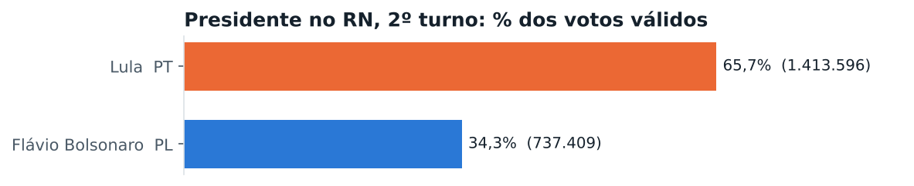
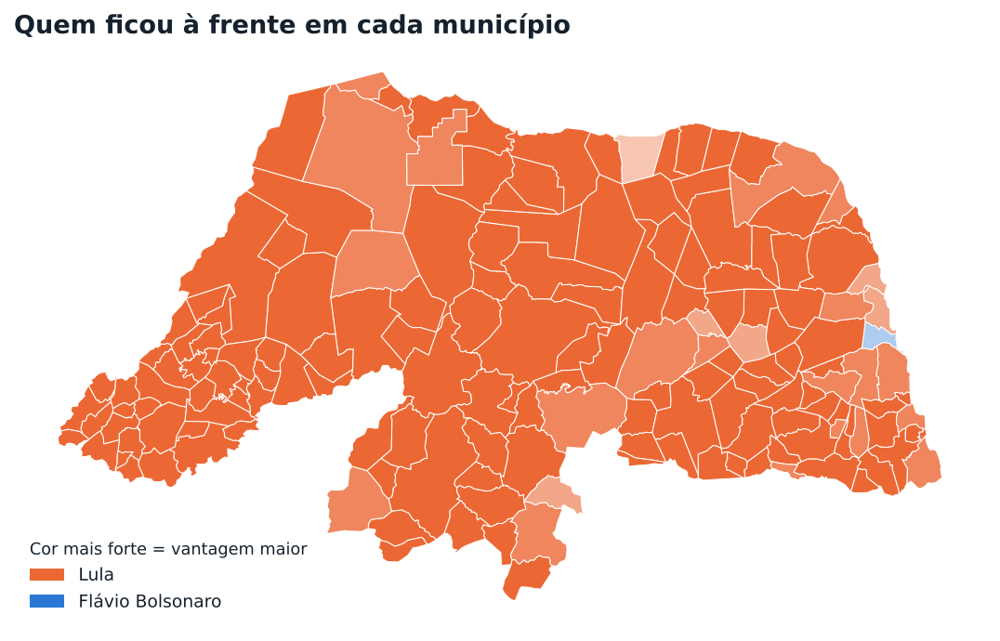
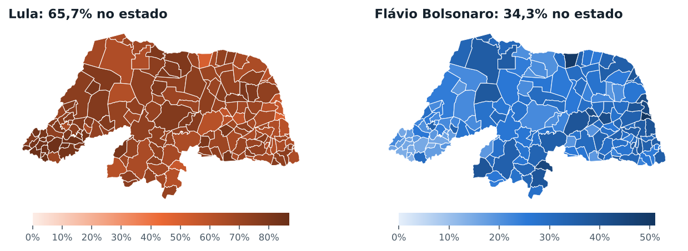
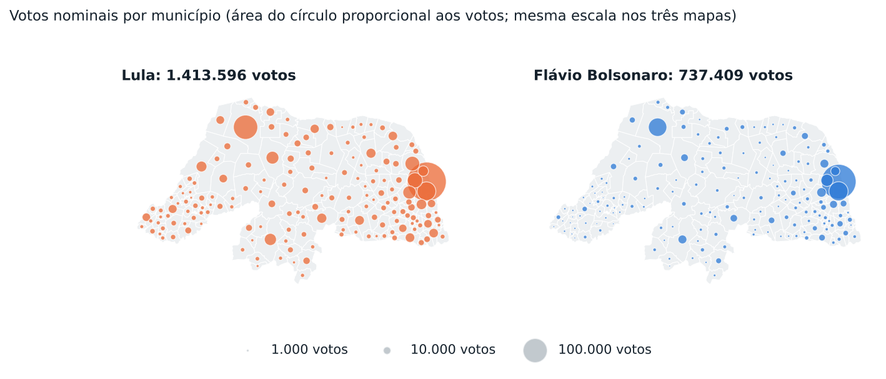
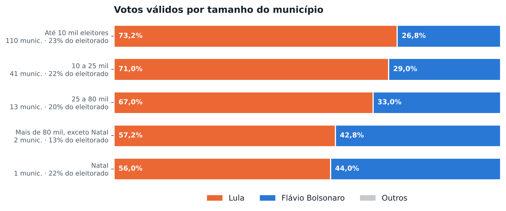
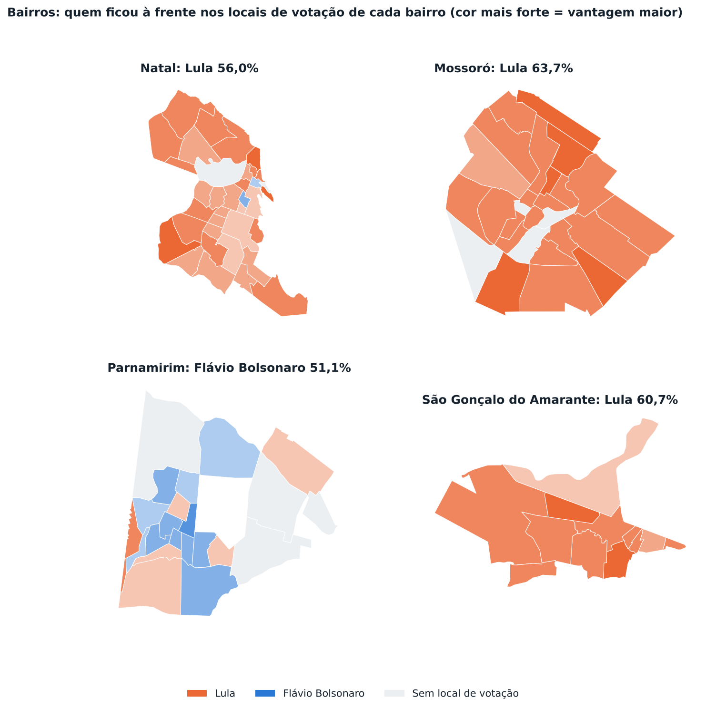
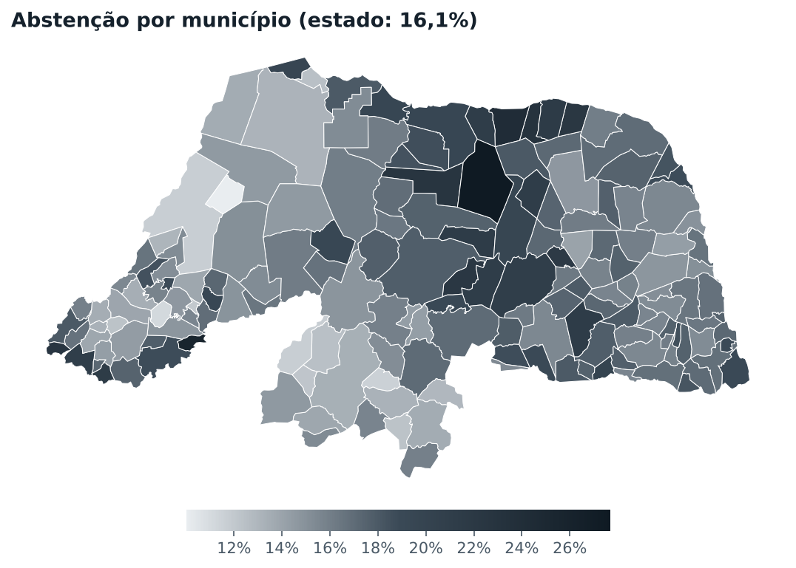

# Eleições 2026 Rio Grande do Norte: Presidente, 2º turno

Relatório gerado a partir dos boletins por seção do TSE (Eleição Ordinária Federal - 2026 2º Turno, 25/10/2026). Percentuais de candidatos são sobre os votos válidos. Versão interativa, com mapa por bairro e por local de votação: [https://felipemechatronics.github.io/Elei-es-2026/?cargo=presidente_2t](https://felipemechatronics.github.io/Elei-es-2026/?cargo=presidente_2t).

## Resumo

- Votos válidos no estado: Lula (PT) 65,7%; Flávio Bolsonaro (PL) 34,3%.
- Primeiro lugar por município, entre os 167 do estado: Lula em 166; Flávio Bolsonaro em 1.
- Compareceram 2.232.823 dos 2.659.867 eleitores aptos (83,9%). Abstenção de 16,1%. Brancos: 0,9%; nulos: 2,8% dos votos.

| Candidato | Partido | Votos | % válidos |
|---|---|---:|---:|
| Lula | PT | 1.413.596 | 65,72% |
| Flávio Bolsonaro | PL | 737.409 | 34,28% |
| Brancos | | 19.939 | |
| Nulos | | 61.879 | |

## O mapa dos municípios

- Mais votos para **Lula**: Natal (258.155), Mossoró (99.790), Parnamirim (59.088), São Gonçalo do Amarante (38.741), Ceará-Mirim (36.107).
- Mais votos para **Flávio Bolsonaro**: Natal (202.844), Parnamirim (61.690), Mossoró (56.965), São Gonçalo do Amarante (25.099), Macaíba (15.215).
- Maiores percentuais de **Lula**: Paraná (86,9%), Luís Gomes (85,8%), Pilões (85,5%), Marcelino Vieira (85,0%), José da Penha (84,9%).
- Maiores percentuais de **Flávio Bolsonaro**: Parnamirim (51,1%), Galinhos (49,8%), Carnaúba dos Dantas (44,5%), Natal (44,0%), Extremoz (42,6%).
- Disputas mais apertadas: Galinhos (Lula por 7 votos), Parnamirim (Flávio Bolsonaro por 2.602 votos), Carnaúba dos Dantas (Lula por 571 votos), Natal (Lula por 55.311 votos), Extremoz (Lula por 4.780 votos).

## Tamanho da cidade

| Faixa | Municípios | Eleitorado | Lula | Flávio Bolsonaro |
|---|---:|---:|---:|---:|
| Até 10 mil eleitores | 110 | 23,5% | 73,2% | 26,8% |
| 10 a 25 mil | 41 | 22,4% | 71,0% | 29,0% |
| 25 a 80 mil | 13 | 20,0% | 67,0% | 33,0% |
| Mais de 80 mil, exceto Natal | 2 | 12,6% | 57,2% | 42,8% |
| Natal | 1 | 21,5% | 56,0% | 44,0% |

## As maiores cidades

| Município | Aptos | Comparec. | Lula | Flávio Bolsonaro | À frente |
|---|---:|---:|---:|---:|---|
| Natal | 573.154 | 83,4% | 56,0% (258.155) | 44,0% (202.844) | Lula +12,0 |
| Mossoró | 187.992 | 86,9% | 63,7% (99.790) | 36,3% (56.965) | Lula +27,3 |
| Parnamirim | 147.653 | 84,9% | 48,9% (59.088) | 51,1% (61.690) | Flávio Bolsonaro +2,2 |
| São Gonçalo do Amarante | 77.511 | 85,7% | 60,7% (38.741) | 39,3% (25.099) | Lula +21,4 |
| Ceará-Mirim | 60.287 | 84,5% | 73,6% (36.107) | 26,4% (12.929) | Lula +47,3 |
| Macaíba | 54.350 | 85,3% | 65,8% (29.317) | 34,2% (15.215) | Lula +31,7 |
| Assú | 45.539 | 84,0% | 74,2% (27.426) | 25,8% (9.541) | Lula +48,4 |
| Caicó | 45.051 | 86,6% | 65,4% (24.689) | 34,6% (13.042) | Lula +30,9 |
| Extremoz | 39.502 | 85,1% | 57,4% (18.603) | 42,6% (13.823) | Lula +14,7 |
| São José de Mipibu | 35.795 | 83,5% | 63,8% (18.328) | 36,2% (10.412) | Lula +27,5 |
| Currais Novos | 32.919 | 82,9% | 64,8% (16.991) | 35,2% (9.219) | Lula +29,7 |
| Apodi | 30.222 | 88,3% | 75,5% (19.463) | 24,5% (6.331) | Lula +50,9 |
| Touros | 28.148 | 83,0% | 64,9% (14.545) | 35,1% (7.878) | Lula +29,7 |
| Nova Cruz | 27.949 | 83,2% | 67,8% (15.158) | 32,2% (7.192) | Lula +35,6 |
| João Câmara | 27.708 | 85,3% | 72,5% (16.514) | 27,5% (6.266) | Lula +45,0 |

## Bairro a bairro

O voto é contado no local onde o eleitor vota, e não onde ele mora. Cada bairro soma os locais de votação que ficam dentro dos seus limites (IBGE, Censo 2022). Bairros sem local de votação aparecem em cinza.

### Natal

Lula ficou à frente em 32 bairros, Flávio Bolsonaro ficou à frente em 2 bairros.

| Bairro | Locais | Votos válidos | Lula | Flávio Bolsonaro | Abstenção |
|---|---:|---:|---:|---:|---:|
| Potengi | 23 | 47.372 | 55,9% (26.489) | 44,1% (20.883) | 16,0% |
| Lagoa Nova | 16 | 39.865 | 50,8% (20.261) | 49,2% (19.604) | 16,4% |
| Lagoa Azul | 19 | 37.208 | 58,3% (21.684) | 41,7% (15.524) | 16,7% |
| Tirol | 13 | 29.645 | 50,5% (14.956) | 49,5% (14.689) | 16,8% |
| Alecrim | 14 | 24.805 | 53,7% (13.329) | 46,3% (11.476) | 17,0% |
| Filipe Camarão | 13 | 23.348 | 60,8% (14.194) | 39,2% (9.154) | 16,0% |
| Pitimbú | 10 | 23.167 | 53,7% (12.431) | 46,3% (10.736) | 15,3% |
| Neópolis | 8 | 22.291 | 55,1% (12.292) | 44,9% (9.999) | 16,1% |
| Nossa Senhora da Apresentação | 10 | 22.146 | 58,9% (13.049) | 41,1% (9.097) | 17,8% |
| Pajuçara | 9 | 21.771 | 57,7% (12.559) | 42,3% (9.212) | 18,0% |
| Capim Macio | 6 | 18.744 | 53,6% (10.053) | 46,4% (8.691) | 18,6% |
| Candelária | 5 | 14.587 | 50,6% (7.377) | 49,4% (7.210) | 16,3% |
| Cidade da Esperança | 7 | 14.019 | 57,5% (8.054) | 42,5% (5.965) | 15,9% |
| Nossa Senhora de Nazaré | 4 | 12.293 | 57,0% (7.003) | 43,0% (5.290) | 15,3% |
| Quintas | 7 | 11.939 | 56,1% (6.702) | 43,9% (5.237) | 15,4% |
| Dix-Sept Rosado | 4 | 9.968 | 56,5% (5.635) | 43,5% (4.333) | 15,7% |
| Planalto | 4 | 9.479 | 57,2% (5.422) | 42,8% (4.057) | 17,2% |
| Cidade Nova | 5 | 8.306 | 58,0% (4.818) | 42,0% (3.488) | 16,6% |
| Petrópolis | 5 | 8.298 | 49,9% (4.137) | 50,1% (4.161) | 17,9% |
| Ponta Negra | 7 | 7.369 | 59,8% (4.408) | 40,2% (2.961) | 20,5% |
| Mãe Luíza | 6 | 7.071 | 70,1% (4.956) | 29,9% (2.115) | 16,6% |
| Bom Pastor | 2 | 6.060 | 59,4% (3.598) | 40,6% (2.462) | 15,3% |
| Santos Reis | 4 | 5.885 | 65,9% (3.880) | 34,1% (2.005) | 16,8% |
| Nordeste | 3 | 5.012 | 55,0% (2.758) | 45,0% (2.254) | 15,2% |
| Igapó | 3 | 4.820 | 58,8% (2.835) | 41,2% (1.985) | 14,0% |
| Redinha | 4 | 4.342 | 64,0% (2.779) | 36,0% (1.563) | 18,0% |
| Guarapés | 3 | 3.843 | 69,2% (2.658) | 30,8% (1.185) | 16,8% |
| Rocas | 2 | 3.629 | 60,8% (2.206) | 39,2% (1.423) | 15,2% |
| Cidade Alta | 1 | 3.082 | 62,0% (1.910) | 38,0% (1.172) | 18,0% |
| Barro Vermelho | 2 | 2.828 | 44,0% (1.244) | 56,0% (1.584) | 16,4% |
| Nova Descoberta | 1 | 2.736 | 58,8% (1.608) | 41,2% (1.128) | 19,2% |
| Lagoa Seca | 1 | 1.938 | 51,8% (1.004) | 48,2% (934) | 17,1% |
| Ribeira | 1 | 1.685 | 56,3% (948) | 43,7% (737) | 16,5% |
| Praia do Meio | 2 | 1.408 | 62,6% (882) | 37,4% (526) | 17,0% |

### Mossoró

Lula ficou à frente em 23 bairros.

| Bairro | Locais | Votos válidos | Lula | Flávio Bolsonaro | Abstenção |
|---|---:|---:|---:|---:|---:|
| Santo Antônio | 7 | 20.724 | 64,2% (13.296) | 35,8% (7.428) | 14,3% |
| Abolição | 7 | 14.173 | 60,9% (8.635) | 39,1% (5.538) | 13,9% |
| Alto de São Manoel | 5 | 13.518 | 62,9% (8.502) | 37,1% (5.016) | 12,8% |
| Lagoa do Mato | 4 | 10.033 | 62,9% (6.308) | 37,1% (3.725) | 11,6% |
| Bom Jardim | 4 | 9.407 | 65,9% (6.197) | 34,1% (3.210) | 12,7% |
| Aeroporto | 5 | 8.249 | 64,4% (5.315) | 35,6% (2.934) | 12,7% |
| Presidente Costa e Silva | 3 | 7.901 | 65,0% (5.133) | 35,0% (2.768) | 12,4% |
| Doze Anos | 4 | 7.098 | 59,7% (4.236) | 40,3% (2.862) | 12,3% |
| Centro | 3 | 6.440 | 59,5% (3.831) | 40,5% (2.609) | 13,0% |
| Planalto Treze de Maio | 3 | 6.365 | 61,1% (3.892) | 38,9% (2.473) | 11,9% |
| Dom Jaime Câmara | 2 | 5.194 | 66,0% (3.429) | 34,0% (1.765) | 14,3% |
| Nova Betânia | 2 | 4.711 | 56,4% (2.656) | 43,6% (2.055) | 14,5% |
| Barrocas | 2 | 4.524 | 66,3% (2.999) | 33,7% (1.525) | 13,9% |
| Santa Delmira | 3 | 4.481 | 62,2% (2.788) | 37,8% (1.693) | 13,4% |
| Alto da Conceição | 4 | 4.280 | 62,0% (2.655) | 38,0% (1.625) | 10,9% |
| Paredões | 2 | 4.067 | 64,8% (2.635) | 35,2% (1.432) | 14,5% |
| Rincão | 2 | 3.416 | 63,3% (2.164) | 36,7% (1.252) | 14,3% |
| Belo Horizonte | 1 | 3.117 | 63,2% (1.971) | 36,8% (1.146) | 13,1% |
| Redenção | 1 | 2.369 | 66,0% (1.564) | 34,0% (805) | 13,7% |
| Alto do Sumaré | 1 | 2.270 | 60,2% (1.366) | 39,8% (904) | 13,4% |
| Pintos | 1 | 1.669 | 64,5% (1.076) | 35,5% (593) | 14,2% |
| Bom Jesus | 1 | 1.317 | 68,2% (898) | 31,8% (419) | 10,1% |
| Dix-Sept Rosado | 1 | 294 | 60,2% (177) | 39,8% (117) | 10,7% |

### Parnamirim

Flávio Bolsonaro ficou à frente em 12 bairros, Lula ficou à frente em 6 bairros.

| Bairro | Locais | Votos válidos | Lula | Flávio Bolsonaro | Abstenção |
|---|---:|---:|---:|---:|---:|
| Nova Parnamirim | 9 | 22.359 | 51,5% (11.519) | 48,5% (10.840) | 15,4% |
| Emaús | 5 | 11.631 | 49,1% (5.710) | 50,9% (5.921) | 14,0% |
| Cohabinal | 4 | 10.996 | 43,0% (4.728) | 57,0% (6.268) | 15,1% |
| Passagem de Areia | 4 | 10.152 | 49,5% (5.026) | 50,5% (5.126) | 15,0% |
| Nova Esperança | 3 | 7.730 | 51,9% (4.010) | 48,1% (3.720) | 17,0% |
| Monte Castelo | 4 | 7.606 | 50,6% (3.851) | 49,4% (3.755) | 13,5% |
| Santa Tereza | 3 | 6.616 | 48,6% (3.215) | 51,4% (3.401) | 14,8% |
| Santos Reis | 2 | 6.379 | 46,2% (2.950) | 53,8% (3.429) | 16,0% |
| Boa Esperança | 3 | 4.794 | 43,6% (2.091) | 56,4% (2.703) | 14,0% |
| Cajupiranga | 3 | 4.440 | 42,9% (1.904) | 57,1% (2.536) | 16,5% |
| Liberdade | 2 | 4.083 | 51,9% (2.121) | 48,1% (1.962) | 14,6% |
| Vida Nova | 1 | 3.733 | 47,3% (1.764) | 52,7% (1.969) | 15,3% |
| Rosa dos Ventos | 1 | 3.191 | 43,9% (1.402) | 56,1% (1.789) | 14,1% |
| Bela Parnamirim | 1 | 2.804 | 57,7% (1.619) | 42,3% (1.185) | 17,0% |
| Centro | 2 | 2.279 | 40,1% (915) | 59,9% (1.364) | 15,6% |
| Vale do Sol | 2 | 2.118 | 51,3% (1.087) | 48,7% (1.031) | 16,0% |
| Parque de Exposições | 2 | 1.781 | 48,2% (858) | 51,8% (923) | 14,5% |
| Jardim Planalto | 1 | 1.638 | 44,7% (733) | 55,3% (905) | 13,5% |

### São Gonçalo do Amarante

Lula ficou à frente em 12 bairros.

| Bairro | Locais | Votos válidos | Lula | Flávio Bolsonaro | Abstenção |
|---|---:|---:|---:|---:|---:|
| Amarante | 3 | 8.736 | 56,0% (4.888) | 44,0% (3.848) | 13,3% |
| Centro | 2 | 8.676 | 62,1% (5.384) | 37,9% (3.292) | 14,3% |
| Jardins | 2 | 7.133 | 50,2% (3.579) | 49,8% (3.554) | 13,2% |
| Santo Antônio do Potengi | 2 | 6.735 | 59,9% (4.035) | 40,1% (2.700) | 15,2% |
| Jardim Lola | 3 | 5.915 | 61,3% (3.628) | 38,7% (2.287) | 14,7% |
| Goladim | 1 | 5.303 | 61,8% (3.278) | 38,2% (2.025) | 14,6% |
| Regomoleiro | 2 | 2.957 | 65,4% (1.935) | 34,6% (1.022) | 12,5% |
| Novo Amarante | 1 | 2.504 | 60,3% (1.510) | 39,7% (994) | 15,9% |
| Olho D'Água | 1 | 2.157 | 59,9% (1.291) | 40,1% (866) | 17,3% |
| Santa Terezinha | 1 | 1.948 | 60,2% (1.172) | 39,8% (776) | 16,5% |
| Guajiru | 1 | 1.206 | 66,0% (796) | 34,0% (410) | 14,7% |
| Maçaranduba | 1 | 1.197 | 64,7% (774) | 35,3% (423) | 14,2% |

## Abstenção

- Maior abstenção: Pedro Avelino (27,7%), João Dias (25,7%), Galinhos (24,3%), Caiçara do Norte (23,0%), Afonso Bezerra (22,8%).
- Menor abstenção: Felipe Guerra (10,0%), Serrinha dos Pintos (11,2%), São José do Seridó (11,6%), Apodi (11,7%), Jardim de Piranhas (11,7%).

## Metodologia e fontes

- Votos por seção: TSE, Portal de Dados Abertos, arquivo `votacao_secao`. Somados por local de votação, bairro e município.
- Eleitorado apto, coordenadas dos locais de votação e atribuição de bairros: cadastro de locais do TSE e malhas do IBGE (municípios e bairros do Censo 2022), na base organizada pelo projeto [Como o RN votou para governador](https://sousapfe.github.io/eleicoesRN/), de Peterson Sousa.
- Percentuais de candidatos sobre votos válidos; comparecimento e abstenção sobre o eleitorado apto; brancos e nulos sobre o comparecimento.
- Os partidos são inferidos pelo número de urna e podem ser corrigidos em `config/candidatos.json`.
